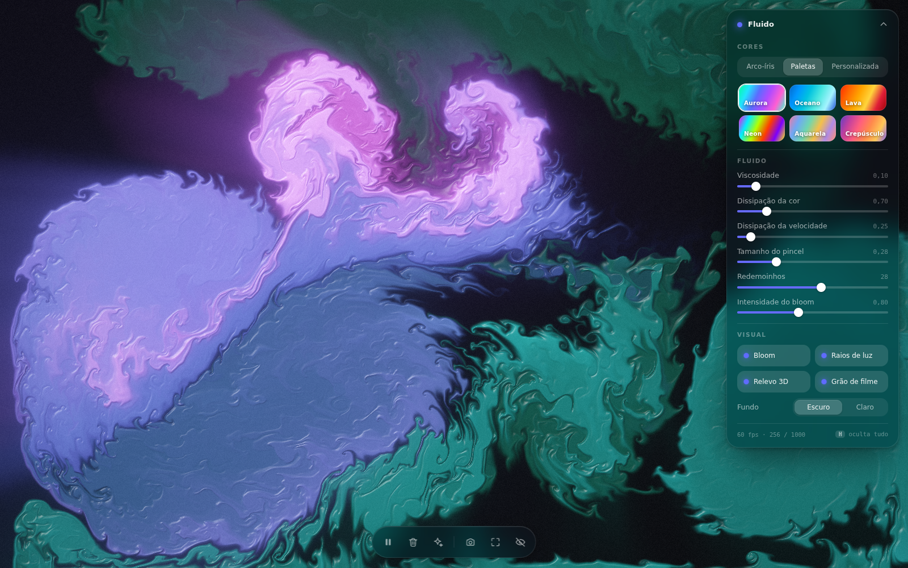
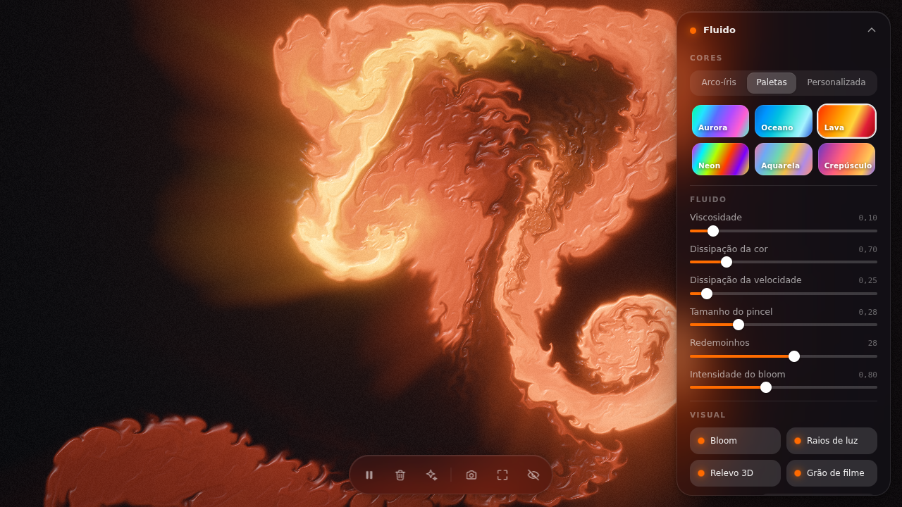
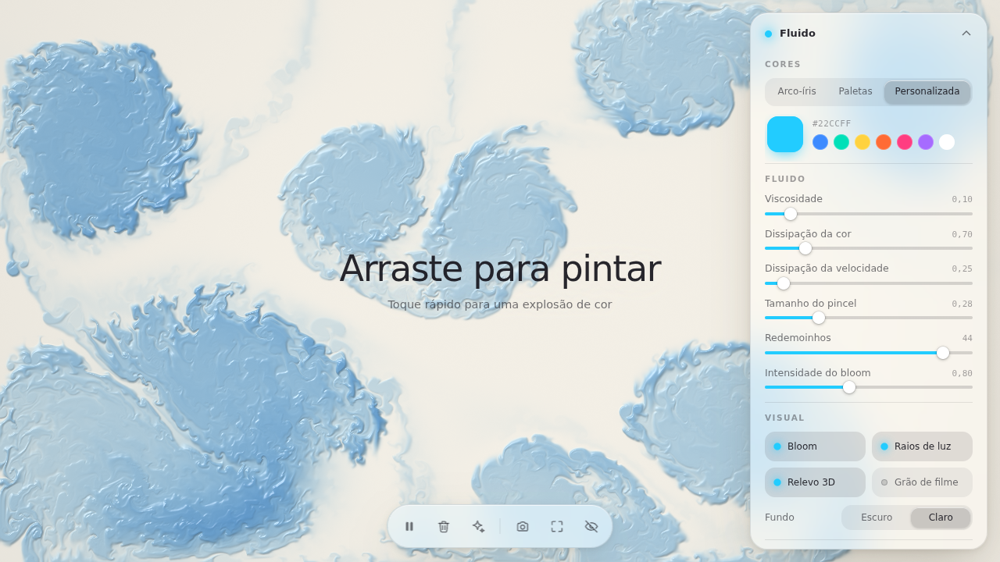
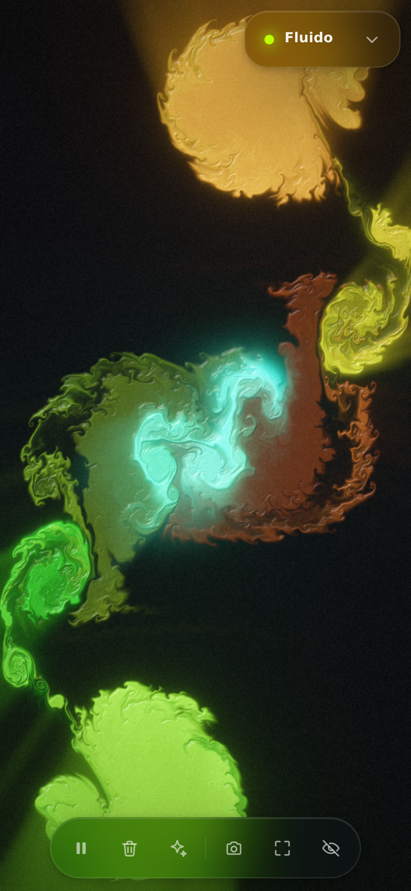

<div align="center">

# Fluido

**Simulação de fluidos interativa, em tempo real, direto no navegador.**

Navier-Stokes na GPU · WebGL2 com fallback para WebGL1 · um único arquivo HTML, zero dependências



</div>

## Sobre

Arraste o mouse ou o dedo e a tela vira tinta em movimento: o fluido é empurrado na direção do gesto, forma redemoinhos, mistura as cores e se dissipa aos poucos. Tudo é calculado na placa de vídeo, quadro a quadro, por shaders escritos à mão.

O projeto inteiro é o [`index.html`](index.html): CSS, JavaScript e os 17 shaders GLSL ficam no mesmo arquivo, sem build, sem bibliotecas e sem servidor.

| Paleta Lava | Fundo claro (aquarela) |
| :---: | :---: |
|  |  |

## Recursos

**Interação**
- Arrastar empurra o fluido e injeta cor na direção do movimento
- Clique ou toque rápido cria uma explosão de cor
- Multitoque: cada dedo pinta com uma cor diferente
- Depois de alguns segundos parado, splats suaves mantêm a tela viva

**Cores**
- **Arco-íris**: o matiz gira continuamente com o tempo
- **Paletas**: Aurora, Oceano, Lava, Neon, Aquarela e Crepúsculo
- **Personalizada**: qualquer cor pelo seletor

**Visual**
- Bloom, raios de luz volumétricos, relevo 3D com brilho especular e grão de filme, cada um com seu interruptor
- Fundo escuro (a tinta emite luz) ou claro (a tinta absorve luz, como aquarela no papel)
- Modo contemplação: a tecla <kbd>H</kbd> esconde toda a interface

**Interface**
- Painel de vidro fosco recolhível, com sliders de viscosidade, dissipação da cor, dissipação da velocidade, tamanho do pincel, redemoinhos e intensidade do bloom
- Captura da tela em PNG e tela cheia
- Responsivo, com as configurações lembradas entre visitas

## Como rodar

Baixe o repositório e abra o `index.html` no navegador. É só isso.

```bash
git clone https://github.com/igor-gregori/fluid-simulator.git
```

Se preferir um endereço `localhost`:

```bash
python3 -m http.server 8000 --directory fluid-simulator
```

e acesse `http://localhost:8000`.

## Atalhos

| Tecla | Ação |
| :---: | --- |
| <kbd>H</kbd> | Ocultar / mostrar a interface |
| <kbd>Espaço</kbd> ou <kbd>P</kbd> | Pausar / continuar |
| <kbd>C</kbd> | Limpar a tela |
| <kbd>R</kbd> | Splats aleatórios |
| <kbd>S</kbd> | Capturar imagem (PNG) |
| <kbd>F</kbd> | Tela cheia |

Em telas de toque, os mesmos comandos estão na barra inferior.



## Como funciona

A simulação segue o método *stable fluids* numa grade regular. A cada quadro:

1. **Vorticidade** — calcula o rotacional da velocidade
2. **Vorticity confinement** — devolve a energia rotacional que a advecção numérica dissipa, mantendo os redemoinhos nítidos
3. **Viscosidade** — difusão implícita da velocidade, resolvida por Jacobi
4. **Projeção de pressão** — resolve a equação de Poisson por Jacobi e subtrai o gradiente, deixando o campo incompressível
5. **Advecção** — transporte semi-lagrangiano da velocidade e da tinta, com dissipação

Depois vem o pós-processamento: pirâmide de bloom, marcha radial dos raios de luz, sombreamento pela normal da superfície, mapeamento de tons e grão.

Alguns detalhes de implementação:

- **Jacobi acelerado.** As iterações da pressão usam pesos de Chebyshev, o que deixou menos da metade da divergência residual do Jacobi puro pelo mesmo custo nos testes. Para o Jacobi clássico, troque `PRESSURE_CHEBYSHEV` para `false`.
- **Unidades independentes da grade.** A velocidade é guardada em "lados menores da tela por segundo", então o comportamento não muda quando a resolução é ajustada.
- **Cor em luz linear.** A tinta é HDR e linear; a curva gama só entra no passe final, o que deixa as misturas limpas.
- **Qualidade adaptativa.** O fps é medido em janelas de 1 s. Se cair, alguns quadros vazios revelam se o limite é da GPU ou da tela/navegador (como num modo de economia de energia); só no primeiro caso a resolução desce um degrau.

| Degrau | Grade da simulação | Tinta | Iterações de pressão |
| :---: | :---: | :---: | :---: |
| 0 | 256 | 1024 | 30 |
| 1 | 192 | 768 | 26 |
| 2 | 128 | 512 | 22 |
| 3 | 96 | 384 | 20 |
| 4 | 64 | 256 | 16 |

Os valores são o número de células no lado menor da tela. Computadores começam no degrau 0 e celulares no 1.

## Organização do código

Tudo está em `index.html`, em blocos comentados:

| Bloco | Conteúdo |
| --- | --- |
| `<style>` | Tokens de tema, painel, barra de ações, responsivo |
| Shaders de simulação | `vs-base`, `fs-splat`, `fs-advection`, `fs-curl`, `fs-vorticity`, `fs-viscosity`, `fs-divergence`, `fs-pressure`, `fs-gradient-subtract`, `fs-copy`, `fs-clear` |
| Shaders de efeitos | `fs-bloom-prefilter`, `fs-bloom-blur`, `fs-sunrays-mask`, `fs-sunrays`, `fs-blur`, `fs-display` |
| JavaScript | Configuração, contexto WebGL, programas, framebuffers, passo da simulação, renderização, cores, entrada, interface, qualidade adaptativa e laço principal |

Cada shader fica na sua própria tag `<script type="x-shader/...">`, em GLSL ES 1.00, e o mesmo código serve ao WebGL2 e ao WebGL1. As constantes de ajuste (`SPLAT_FORCE`, `DYE_RATE`, `QUALITY_LEVELS`, `PALETTES`...) estão no topo do script.

## Compatibilidade

Precisa de um navegador com WebGL e suporte a renderização em texturas de meio-float, o que cobre os navegadores atuais de desktop e celular. Em GPUs sem filtragem linear de ponto flutuante, a simulação continua funcionando, com bloom e raios de luz desativados. Sem WebGL, a página mostra um aviso no lugar da simulação.

A fonte Inter é carregada do Google Fonts de forma opcional; offline, entra a fonte do sistema.

## Créditos

A arquitetura dos passes segue a linha clássica de *Stable Fluids* (Jos Stam), do capítulo 38 de *GPU Gems* e do conhecido [WebGL Fluid Simulation](https://github.com/PavelDoGreat/WebGL-Fluid-Simulation) de Pavel Dobryakov.
